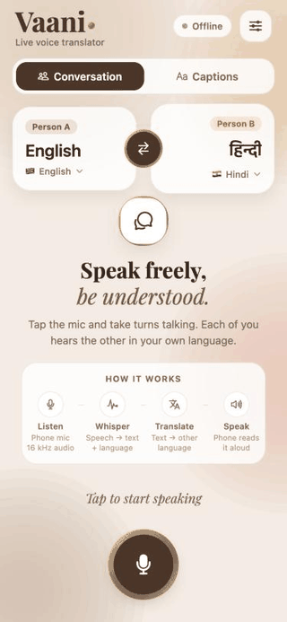
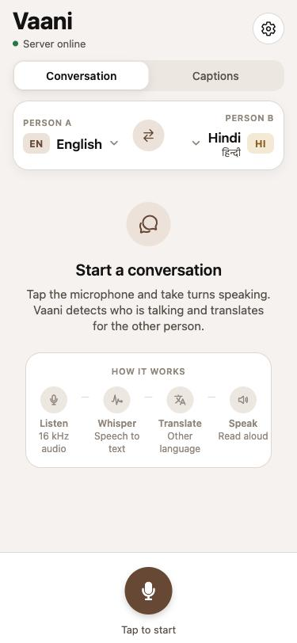
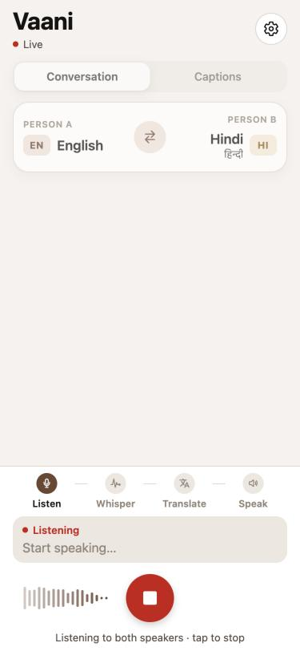
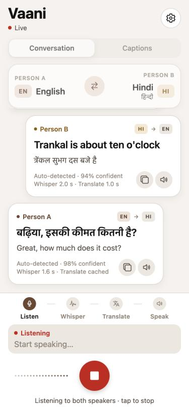
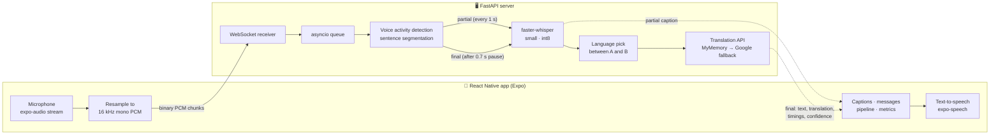

# Vaani: real-time voice translator

**Speak in your language and be heard in theirs.** Vaani streams live speech from a phone to a Python server, transcribes it with Whisper, translates it, and speaks the translation back, sentence by sentence, in about 2 seconds.

In **conversation mode**, two people who speak different languages share one phone. Vaani works out *who* is talking from the language they speak and translates in the right direction automatically. Nobody has to press a "Hindi → English" button.


<p align="center">
  
  <br>
  <sub>English ⇄ Hindi conversation: live captions, then each sentence is translated for the other person.<br>
  Recorded from the app's web build, fed with synthetic voices (macOS text-to-speech).</sub>
</p>

<p align="center">
  
  
  
</p>

---

## Features

- **Live streaming speech recognition.** Audio is sent every ~100 ms over a WebSocket. Rough live captions appear while you speak, then a more accurate final transcript arrives when you pause.
- **Two-way conversation mode with automatic direction switching.** Whisper's language scores are restricted to the two chosen languages, so each sentence is routed A → B or B → A without any button.
- **One-way captions mode.** A fixed source → target, for lectures, announcements and videos.
- **Spoken translations.** Text-to-speech on the phone, with the mic muted while it speaks so the app doesn't translate its own voice.
- **Visible metrics.** Every message shows Whisper time, translation time and language-detection confidence. A session line shows the average delay.
- **18 languages**, including Hindi, Bengali, Tamil, Telugu, Marathi, Gujarati, Kannada, Malayalam, Punjabi and Urdu.
- **Resilient translation layer.** Free APIs are tried in order, with an in-memory cache for repeated phrases.

## Architecture



### How a sentence flows through the system

1. **Capture.** The phone streams raw 16-bit PCM. Phones record at 44.1/48 kHz, so the app downsamples to 16 kHz, using averaging as a simple anti-aliasing filter, before sending.
2. **Segment.** The server splits the stream into 30 ms frames and measures loudness (RMS) against an adaptive noise floor. It keeps 300 ms of pre-roll so first syllables aren't cut, ignores sounds shorter than 300 ms, and ends a sentence after 0.7 s of silence or 15 s of speech.
3. **Transcribe.** While someone is speaking, the audio so far is transcribed about once a second with greedy decoding (fast, rough). When the sentence ends, it is transcribed again with beam search (slower, accurate).
4. **Pick the direction.** Whisper scores ~100 languages. Vaani compares only the two the users chose. The winner becomes the source language and the other becomes the target.
5. **Translate and reply.** The final transcript, translation, per-stage timings and confidence go back to the phone as one JSON message.

### Two-way direction switching

```python
probs = dict(info.all_language_probs)               # Whisper's score for every language
best = max(["en", "hi"], key=lambda c: probs.get(c, 0))
target = "hi" if best == "en" else "en"              # the other person's language
```

Restricting the choice to two languages also makes detection much more reliable than open-ended language ID, especially for short sentences.

### WebSocket protocol

| Direction | Message |
|---|---|
| phone → server | `{"type": "start", "languages": ["en", "hi"]}` for two-way, or `{"languages": ["en"], "target": "fr"}` for one-way |
| server → phone | `{"type": "ready"}` |
| phone → server | binary frames: 16 kHz mono int16 PCM, ~100 ms each |
| server → phone | `{"type": "partial", "text": "...", "lang": "en"}` |
| server → phone | `{"type": "final", "text", "lang", "translation", "target", "confidence", "timing_ms": {"speech", "translate"}}` |
| phone → server | `{"type": "stop"}` finishes the current sentence |

## Performance

Measured on a MacBook Air (Apple M5, CPU only, Whisper `small`, int8), streaming at real-time speed:

| Stage | Typical time |
|---|---|
| Live (partial) caption | 0.8–1.0 s |
| Final transcript, English sentence | ~1.6 s |
| Final transcript, Hindi sentence | ~2.2 s |
| Translation (network API) | 0.7–1.9 s (instant when cached) |
| **End of sentence → translation on screen** | **~2.5–4 s** |

## Engineering challenges

| Problem | Fix | Result |
|---|---|---|
| Hindi live captions took **~12 s** each. Whisper's temperature fallback re-decoded uncertain audio up to 5 times, and short clips fell into repetition loops ("अगर अगर अगर…") | `temperature=0`, `no_repeat_ngram_size=3`, output tokens capped at ~20 per second of audio | **11.8 s → 0.9 s** per partial |
| Captions lagged further and further behind while Whisper was busy | The receiver only queues audio. The worker drains the whole queue each cycle and transcribes only the newest partial | Captions never fall behind the speaker |
| The phone translated its own text-to-speech output | Mic audio is dropped while the phone is speaking | No feedback loop |
| The free Google endpoint started returning *429 Too Many Requests* | Provider chain (MyMemory → Google) with timeouts, an LRU cache, and handling for MyMemory's blank crowd-sourced entries | Translation keeps working when one provider fails |
| One Whisper model shared by many connections | Model loaded once at startup, guarded by an `asyncio.Lock`, run in a worker thread | The server stays responsive |

## Project structure

```
VoiceTranslator/
├── backend/
│   ├── main.py            FastAPI app: /health and the /ws streaming endpoint
│   ├── asr.py             voice activity detection + faster-whisper transcription
│   ├── translator.py      translation providers, cache and direction logic
│   ├── tests/             pytest: segmentation, translation logic, WebSocket protocol
│   ├── test_ws_client.py  streams a WAV file like a phone, for manual testing
│   └── samples/           test recordings (English/Hindi conversation)
├── mobile/
│   ├── App.js             main screen
│   └── src/
│       ├── useMicrophone.js      phone mic → 16 kHz PCM (expo-audio)
│       ├── useMicrophone.web.js  browser mic (Web Audio API)
│       ├── useTranslator.js      WebSocket client
│       ├── audio.js              resampling
│       └── components/           pipeline, message cards, mic, waveform…
└── screenshots/
```

## Run it yourself

### Backend (Python 3.12)

```bash
cd backend
python3.12 -m venv .venv && source .venv/bin/activate
pip install -r requirements.txt
uvicorn main:app --host 0.0.0.0 --port 8500
```

The first start downloads the Whisper model (~460 MB). Use `WHISPER_MODEL=base` for a faster, less accurate model, or `medium` for better Hindi.

Quick check without a phone:

```bash
python test_ws_client.py samples/conversation.wav en,hi
```

### Mobile app

```bash
cd mobile
npm install
npx expo start
```

Scan the QR code with **Expo Go** on a phone that's on the same Wi-Fi as the server. Set your computer's IP in `mobile/src/config.js`, or in the app under Settings → Server address. Press `w` to run it in a browser instead.

### Tests

```bash
cd backend && pytest -v
```

## Limitations and future work

- Accuracy for Indian languages is limited by the `small` model. `medium`, or a GPU, would improve it.
- Loudness-based voice detection can be confused by steady background noise. A neural VAD (Silero) would be more robust.
- Translation uses free public APIs. A self-hosted model (e.g. NLLB or IndicTrans2) would allow fully offline use.
- Run on-device with whisper.cpp to remove the server entirely.

## License

[MIT](LICENSE) © 2026 Kashish Awasthi
